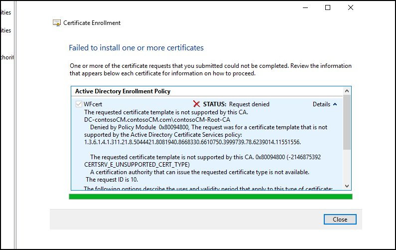
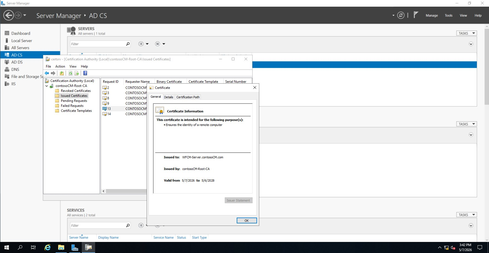
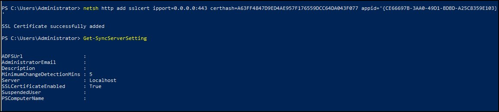
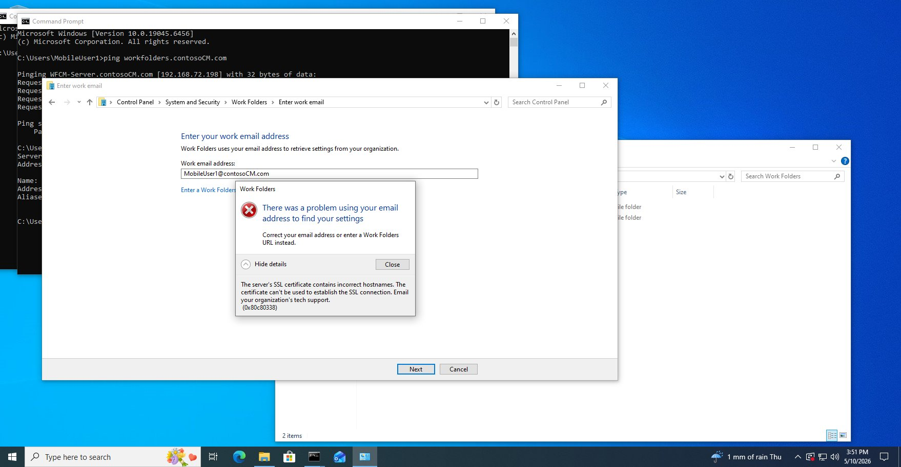
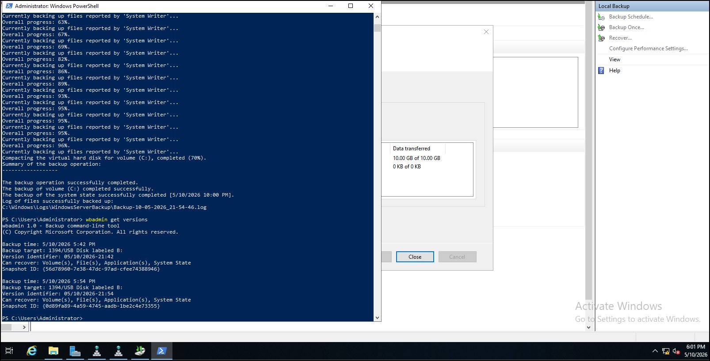

# Work Folders, AD CS et sauvegarde/restauration Active Directory

Laboratoire Windows Server réalisé dans le cadre de mon programme en réseautique et cybersécurité.

Objectif : offrir aux utilisateurs mobiles une synchronisation de fichiers sécurisée en HTTPS avec **Work Folders**, à l'aide d'un certificat émis par ma propre autorité de certification (**AD CS**), puis sauvegarder Active Directory et **restaurer un objet supprimé** par une restauration *authoritative*.

## Sommaire

- [Environnement](#environnement)
- [Compétences démontrées](#compétences-démontrées)
- [1. Certificat WFCert avec AD CS](#1-certificat-wfcert-avec-ad-cs)
- [2. Work Folders](#2-work-folders)
- [3. Tests côté client](#3-tests-côté-client)
- [4. Sauvegarde AD avec Windows Server Backup](#4-sauvegarde-ad-avec-windows-server-backup)
- [5. Restauration authoritative](#5-restauration-authoritative)
- [Problèmes rencontrés et solutions](#problèmes-rencontrés-et-solutions)
- [Ce que j'en retiens](#ce-que-jen-retiens)

## Environnement

| Élément | Détail |
|---|---|
| Domaine | `contosoCM.com` |
| Contrôleur de domaine / CA | `DC-contosoCM` (AD DS, DNS, AD CS, autorité racine `contosoCM-Root-CA`) |
| Serveur Work Folders | `WFCM-Server` (IIS, Work Folders) |
| Client | Windows 10 joint au domaine, session `MobileUser1` |
| Virtualisation | Hyper-V |

## Compétences démontrées

- Création et sécurisation d'un **modèle de certificat** (Key Usage, clé exportable, droits Enroll limités)
- Publication d'un modèle sur la CA et émission manuelle d'un certificat en attente
- Déploiement de **Work Folders** : sync share, dossiers par UPN, chiffrement et verrouillage imposés aux appareils
- Liaison d'un certificat SSL à **HTTP.sys** avec `netsh http add sslcert`
- Découverte automatique via l'attribut AD `msDS-SyncServerURL`
- **Windows Server Backup** / `wbadmin` (System State)
- Démarrage en **DSRM** et restauration **authoritative** avec `ntdsutil`
- Dépannage méthodique : conflit de port 443, erreurs de CA, incohérence de nom SSL

---

## 1. Certificat WFCert avec AD CS

Le domaine et AD CS étaient déjà en place depuis le TP précédent. J'ai créé le groupe global de sécurité `GG-MobileUsers`, l'utilisateur `MobileUser1` (membre du groupe), joint `WFCM-Server` au domaine et installé le rôle IIS.

### Modèle de certificat

J'ai dupliqué le modèle **Web Server** dans `certsrv.msc` pour créer **WFCert**, puis modifié ces onglets :

| Onglet | Réglage | Pourquoi |
|---|---|---|
| Request Handling | **Allow private key to be exported** coché | Le certificat doit être lié au service web de WFCM-Server |
| Extensions → Key Usage | **Nonrepudiation décoché** ; on garde Digital Signature + Key Encipherment | La non-répudiation sert à signer des documents, pas au HTTPS |
| Subject Name | **Build from this Active Directory information** | Le nom du certificat correspond au nom DNS du serveur (`WFCM-Server.contosoCM.com`) |
| Security | Authenticated Users retiré ; `WFCM-Server$` ajouté avec **Enroll** | Seul le serveur qui en a besoin peut obtenir ce certificat |

### Publication sur la CA

Créer le modèle ne suffit pas : la CA doit être autorisée à l'émettre. Sans publication, la demande est refusée avec `CERTSRV_E_UNSUPPORTED_CERT_TYPE` :


*Demande refusée tant que le modèle n'est pas publié*

Publication : `certsrv.msc` → Certificate Templates → New → **Certificate Template to Issue**.

### Demande et émission

Depuis WFCM-Server : `mmc` → Certificates (Local Computer) → Personal → All Tasks → **Request New Certificate** → WFCert. La demande tombe en *Pending* (exigence d'émission configurée), puis je l'approuve (**Issue**) dans `certsrv.msc`.


*Certificat émis pour WFCM-Server.contosoCM.com*

J'ai ensuite ajouté un binding HTTPS (port 443) avec WFCert dans IIS. Naviguer vers `https://localhost` donne un avertissement de nom, ce qui est normal : le certificat est émis pour `WFCM-Server.contosoCM.com`, pas pour `localhost`.

---

## 2. Work Folders

Rôle installé via File and Storage Services → File and iSCSI Services → **Work Folders**.

### Sync share

| Paramètre | Valeur | Pourquoi |
|---|---|---|
| Nom | `WorkFolders-ContosoCM` | |
| Chemin | `C:\WorkFolders` | |
| Structure des dossiers | `[user]@[domain]` | Un sous-dossier unique par UPN (`MobileUser1@contosoCM.com`), pas de collision entre utilisateurs |
| Accès | `GG-MobileUsers` | On gère l'accès en ajoutant ou retirant les membres du groupe |
| Politiques d'appareil | Chiffrement + verrouillage automatique de l'écran | Work Folders peut synchroniser vers des appareils personnels non gérés |

### URL de découverte

L'énoncé demandait `Set-SyncServerSetting -DiscoveryUrl`, mais ce paramètre n'existe pas dans cette version de Windows Server. J'ai d'abord essayé une clé de registre sur le serveur, mais le client ne la lit pas.

J'ai finalement utilisé la méthode documentée par Microsoft, l'attribut AD `msDS-SyncServerURL` :

```powershell
Set-ADUser -Identity "MobileUser1" -Replace @{"msDS-SyncServerURL"="https://WFCM-Server.contosoCM.com"}
```

### Liaison du certificat SSL à Work Folders

C'est l'étape la plus complexe du laboratoire (voir [Problèmes rencontrés](#problèmes-rencontrés-et-solutions)). La solution a été de lier le certificat directement à **HTTP.sys** :

```powershell
Get-ChildItem Cert:\LocalMachine\My | Format-List Subject, Thumbprint

netsh http add sslcert ipport=0.0.0.0:443 `
    certhash=A63FF4847D9ED4AE957F176559DCC64DA043F077 `
    appid='{CE66697B-3AA0-49D1-BDBD-A25C8359E103}'
```

- `ipport=0.0.0.0:443` : toutes les interfaces, port 443
- `certhash` : empreinte (thumbprint) du certificat WFCert
- `appid` : GUID du service Work Folders


*`SSLCertificateEnabled : True`*

Dans IIS → Authentication : **Windows Authentication** activée, **Anonymous** désactivée.

---

## 3. Tests côté client

**Découverte par courriel** (`MobileUser1@contosoCM.com`) : échec.

Le client cherche `workfolders.<domaine>`. J'ai donc créé un CNAME `workfolders.contosoCM.com` → `WFCM-Server.contosoCM.com`.

La résolution DNS fonctionnait, mais le certificat ne contenait pas ce nom (erreur `0x80c80338`) :



Pour corriger ça, il aurait fallu ajouter `workfolders.contosoCM.com` comme **SAN** dans le certificat. L'énoncé demandait l'URL directe, alors j'ai utilisé **Enter a Work Folders URL instead** → `https://WFCM-Server.contosoCM.com`. Le client a accepté les politiques (chiffrement, verrouillage) et la configuration s'est terminée.

**Synchronisation** : un fichier créé dans `C:\Users\MobileUser1\Work Folders` apparaît dans `C:\WorkFolders\MobileUser1@contosoCM.com\` sur le serveur, et la synchronisation fonctionne aussi dans l'autre sens.

---

## 4. Sauvegarde AD avec Windows Server Backup

1. Fonctionnalité **Windows Server Backup** installée sur DC-contosoCM
2. Disque virtuel ajouté dans Hyper-V, initialisé et formaté en NTFS (lettre `B:`)
3. Utilisateur `TestUserBackup` créé dans l'OU `Ventes`
4. Sauvegarde (System State + C:) depuis l'interface, puis en ligne de commande :

```powershell
wbadmin start backup -backupTarget:B: -systemState -vssFull -quiet
wbadmin get versions
```


*Sauvegarde terminée et versions disponibles*

5. **Simulation de l'incident** : suppression de `TestUserBackup` dans ADUC

---

## 5. Restauration authoritative

**Démarrage en DSRM** : `msconfig` → Boot → Safe boot → **Active Directory repair** → redémarrage, puis connexion avec le compte Administrator local et le mot de passe DSRM.

**Restauration du System State** (sans redémarrer après) :

```powershell
wbadmin start systemstaterecovery -version:05/10/2026-21:54 -backupTarget:B: -quiet
```

**Marquer l'OU comme authoritative** avec `ntdsutil`, toujours sans redémarrer :

```text
ntdsutil
activate instance ntds
authoritative restore
restore subtree "OU=Ventes,DC=contosoCM,DC=com"
quit
quit
```

Ensuite, j'ai décoché Safe boot dans `msconfig` et redémarré normalement. **`TestUserBackup` est revenu dans l'OU Ventes.**

### Non-authoritative ou authoritative ?

| | Non-authoritative | Authoritative |
|---|---|---|
| Effet | Restaure AD, puis la réplication remet la version la plus récente des autres DC | La version restaurée devient la référence et se réplique vers les autres DC |
| Cas d'usage | DC corrompu ou reconstruit | **Objet supprimé par erreur** (notre cas) |

Avec une restauration non-authoritative, la suppression de `TestUserBackup` aurait été répliquée de nouveau et l'objet aurait disparu encore une fois.

---

## Problèmes rencontrés et solutions

| Problème | Cause | Solution |
|---|---|---|
| `CERTSRV_E_UNSUPPORTED_CERT_TYPE` | Modèle créé mais pas publié sur la CA | Certificate Template to Issue |
| `-DiscoveryUrl` introuvable | Paramètre absent de cette version | Attribut AD `msDS-SyncServerURL` |
| `SSLCertificateEnabled` reste à `False`, Work Folders ne répond plus ou erreur WS-Management à la création du sync share | Work Folders réserve `https://*:443/` dans HTTP.sys et **entre en conflit avec IIS** sur le port 443 : le premier service démarré prend le port | Lier le certificat directement à HTTP.sys avec `netsh http add sslcert` |
| Découverte par courriel : `0x80c80338` | `workfolders.contosoCM.com` absent du certificat | Ajouter un SAN (non requis ici) ou utiliser l'URL directe |

## Ce que j'en retiens

- Un certificat « valide » ne suffit pas : **le nom demandé par le client doit figurer dans le certificat** (CN ou SAN).
- Certains services Windows (Work Folders, WinRM…) passent par **HTTP.sys** sans IIS. Il faut donc comprendre qui écoute sur un port avant d'ajouter un binding.
- Pour un objet supprimé par erreur, la restauration doit être **authoritative**, sinon la réplication efface le travail.

## Scripts

Les commandes utilisées sont regroupées dans [`scripts/`](scripts/).
